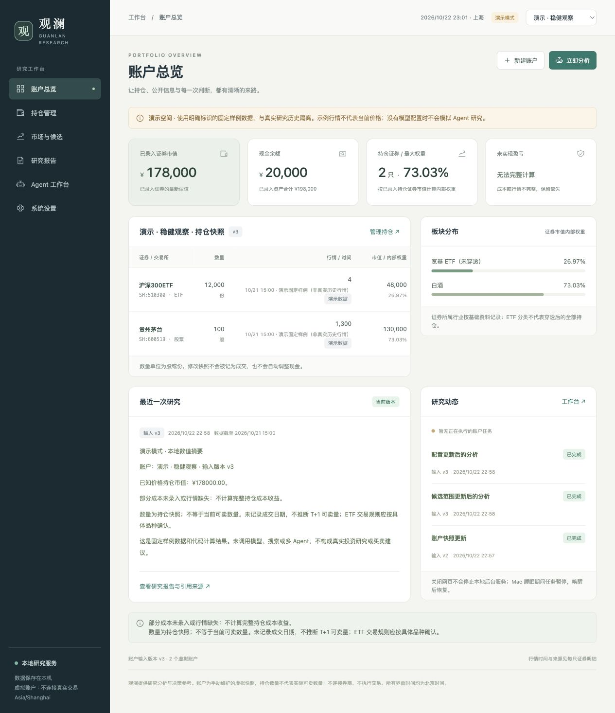

# 观澜 · AI-Powered Portfolio Intelligence

运行在 Mac 本机的 A 股与场内 ETF 虚拟账户研究工作台。FastAPI + SQLite + asyncio 后台执行器 + 无构建依赖的原生 JavaScript 界面。主 Agent 和每个子 Agent 都有独立模型上下文及真实工具调用循环；模型原生联网与本地研究工具在同一 Agent 会话协作，不需要独立搜索密钥。

**第十轮提供六位代码录入、持久任务追踪与报告入口，修复弹窗/表单/引用交互，并补充真实日线与公开文档访问路径。逐项结果、原报告和限制见[第十轮交付](docs/iteration-10.md)、[现场诊断](docs/iteration-10-site.md)和[取数诊断](docs/iteration-10-research.md)。[第九轮](docs/iteration-9.md)、[第八轮](docs/iteration-8.md)及更早交付保留为历史证据。供应商与统一角色操作保持[原有方式](docs/sixth-provider-roles.md)，[预测评估口径](docs/forecast-evaluation.md)不变。**

第三轮历史失败仍保留在 [验证记录](docs/verification.md)，不被新结果覆盖。

第七轮补充修复与 A 的两轮真实复验见 [占位终止与汇总断连](docs/iteration-7-followup.md)：Responses 流式接收、终止调用校验和紧凑汇总已验证，研究资料缺口与尚无成熟方向样本的限制单独记录。

**第十一轮加入手动虚拟买卖、资金与费用账本，修复角色阅读跳顶，并拆分流式等待、空闲和总预算。结果与边界见[第十一轮交付](docs/iteration-11.md)。** 不读取券商账户、不登录券商、不下单、不撮合交易。



## 在 Mac 上启动

完整的启停、升级、换机和暂停范围见 [Mac 运行说明](docs/mac-operations.md)。

需要 Python 3.12+，推荐 Apple Silicon 上使用 Homebrew Python 或 `uv`。本次开发机为 macOS Apple Silicon，使用 Python 3.14。日常运行无需 Node、npm 或 CDN；只需一个后台进程。开发时的浏览器回归需要 Node 20+ 和 Playwright。

```sh
cd "/Users/chn/Documents/ChatGPT/金融股票 2"
uv sync --frozen
./start.command
```

打开 <http://127.0.0.1:8765>。首次启动自动初始化 `data/live.sqlite3`，没有示例账户。模型连接在网页录入，正常使用无需手工填写 `.env` 的模型名或 Key；已有 `.env` 保留作为迁移和运行环境兼容输入。也可以 Finder 双击 `start.command`；已存在 `.venv` 时不会重新安装依赖。

没有 `uv` 时：

```sh
python3 -m venv .venv
.venv/bin/python -m pip install -r requirements.txt
.venv/bin/python scripts/manage.py start
```

停止与查看状态：

```sh
./stop.command
.venv/bin/python scripts/manage.py status
```

前台诊断：`.venv/bin/python scripts/serve.py`。日志在 `data/live.log`。服务只监听回环地址，禁止跨站写请求；首版不提供远程多用户认证。不要使用多个 Uvicorn workers；数据库锁会拒绝同库第二个后台进程。

后台进程启动后，关闭网页不会停止任务。Mac 睡眠期间程序不会持续运行；唤醒后检测时间间隔、刷新数据并仅处理最新输入。退出服务或重启电脑后需再次启动；本版不擅自安装登录项/LaunchAgent，也没有系统推送通知。

## 先体验界面和精确计算

```sh
./start.command --mode demo
```

打开 <http://127.0.0.1:8766>，点击“创建演示样例”。演示使用独立 `data/demo.sqlite3`、明确标记的固定价格和本地计算摘要；**不模拟模型、新闻或子 Agent 研究**。真实模式禁止写入演示种子。停止：`./stop.command --mode demo`。

## 启用真实研究

1. 打开 **模型供应商**，只录入 API Key、Base URL 和 Responses / Chat Completions 协议。Key 由后端保存到 macOS 钥匙串，页面随后只显示已配置标志与掩码；留空表示保留，替换和清除是不同操作。系统生成供应商 ID 与显示标识，不在这里设置默认模型或 effort。
2. 保存后自动请求该供应商的模型列表。保留 API 前缀，例如 `/custom/v1`；粘贴 `/responses` 或 `/chat/completions` 完整地址会明确规范化为同一 API 根路径，供目录与推理共用。列表可以刷新、搜索或继续加载分页。认证失败、接口未支持、超时、真实空列表、部分列表与过期缓存分别显示；无法发现时不会填充热门模型或要求手工输入模型名。
3. 打开 **Agent 角色**，为主 Agent、公告披露、市场价格、行业政策、ETF 指数、组合配置六个角色选择供应商、已发现模型及默认 effort。角色职责、提示词和工具统一管理，新增或归档也全局生效。主 Agent 按本轮需要选择子角色，可直接研究，也可对同一角色创建多个独立专题实例。
4. 创建账户后，打开 **账户模型**。每个账户自动拥有相同的完整角色行，只可覆盖各行的供应商/模型与 effort；清除覆盖恢复默认，不移除角色。供应商和模型成对继承，只覆盖 effort 时保留完整默认模型绑定。模型和强度由用户选择，主 Agent 不能自行切换。
5. 需要积累正式前瞻预测时，打开 **预测评估**，选定账户并展开固定批次设置，明确启用“正式预测批次”。新账户和升级账户默认关闭此新功能，启用后每个交易日会增加模型研究费用。默认在收盘数据可用后的 15:30 发起，当日 18:00 截止；短线、中线、长线默认分别为未来 1、5、20 个交易日，震荡区间为整个期限的 ±0.5%。这些期限、标签、阈值和时间均可修改，修改只影响以后批次。

`reasoning_effort` 仅接受 `low`、`medium`、`high`、`xhigh`、`max`，兼容默认 `medium`。Responses 实际发送 `reasoning.effort`，Chat Completions 实际发送 `reasoning_effort`；不自动降档、删参数或切协议。角色配置显示继承来源及最终值。迁移把旧连接提取为供应商，把旧模型与 effort 移到统一角色默认；历史模型名标记为待目录确认，不伪称已发现。旧环境变量仍可作为内部凭据引用，正常新建不要求用户填写变量名。

排队任务在后台领取时冻结完整目录、角色提示词/工具版本、每个角色的有效模型绑定及供应商/凭据修订。在途子任务、追问与 HTTP 重试使用各自冻结配置；新设置供后续任务使用。Key 轮换保留旧引用供已经启动的任务继续；明确清除凭据后，旧实例在下次 HTTP 请求前停止，已经在途的请求无法召回。历史任务和预测保留原团队归属。检查点恢复会说明已读材料版本、需要补查的更正和新旧团队关系，不把旧报告改署为新模型。

系统设置中的“检测原生联网”和“检测本地工具续接”针对全局主 Agent 当前默认绑定，都会执行有界真实模型请求并可能产生费用。列表发现、函数调用、原生联网、服务明确回报 effort 是不同证据；某一组合通过不代表其他角色组合也通过。页面刷新不会对目录中所有模型执行付费探测。上游模型身份不由网关别名独立证明。

`model_native_search` 默认开启，使用当前角色自己的模型连接；主/子 Agent 自主决定是否搜索。第六轮保持已有 Responses 原生 `web_search` 能力与限制，Chat Completions 可做本地函数研究但没有新增原生网页搜索适配，不切换 Tavily/Brave、不静默改协议。实际可用性以当前组合的真实响应为准。

真实行情默认尝试东方财富网页数据途径，连接失败时可使用新浪公开网页报价（`QUOTE_FALLBACK_PROVIDER=sina`，设 `none` 关闭），不绕过限流、不需要付费密钥。60 秒为初始刷新频率，受对方服务可用性和使用条件限制。页面区分源时间、获取时间、来源和缓存失败状态。已启用的报价通道都失败时，休市可从同供应商未复权日线取得最近有效收盘价，明确日期精度，不能作为盘中报价触发条件；全通道失败则保留已保存报价或未知。可将 `MarketProvider` 替换为你有权使用的供应商；`manual` 当前表示停用联网行情，不会生成报价。北京市场映射尚未做真实证券探测，停牌状态与 ETF 具体交易规则无法从当前报价端点完整确定。

## 使用路径

1. 创建账户并确认期初现金；已有证券可明确作为期初持仓导入。日常买卖直接录入六位代码（例如 `518880`、`002354`、`159599`、`159278`、`000001`），确认名称/市场并填写整数股/份；已有 `SH:600519` 等规范输入继续兼容。身份由精确目录/已确认缓存解析，识别成功不等于实时行情已取得或全部品种都支持记账；未确认交易规则会明确提示，错误不保存并保留草稿。
2. 日常在**持仓管理 → 买入/卖出**录入已确认的模拟成交价、股/份数和时间；后端同时更新现金、数量、含费成本与研究版本。**费用方案**可填写股票/ETF实际佣金、最低收费及过户费包含关系；默认模板标为估算，一笔记录按一笔收费。**资金记录**用于转入/转出，**高级：期初/快照校正**需依据，不能当成交。旧持仓原值保留、不追溯扣现金；现金未知需先有依据补齐，成本未知只限制盈亏计算。详见[账务规则](docs/iteration-11-ledger.md)和[费率来源](docs/iteration-11-fee-sources.md)。
3. 分别维护自选列表和候选范围。持仓自动纳入监控；移除一个账户的持仓不影响其他账户、自选和活动任务的监控需求。候选范围为全局配置，改变时更新相关账户版本。
4. 保存立即返回新版本与代码计算指标；有研究对象时排入分析，空范围需明确选择现金/偏好分析或先保存证券。账户总览顶部的任务卡显示账户、输入版本、范围、任务ID和真实阶段；其他页保留短反馈及查看入口。排队不表示已开始运行。完成后点“查看账户报告/查看证券报告”，引用定位默认折叠。请求结果未知时按操作ID核对，不盲目重发。
5. 账户更新后旧报告标记过期。旧任务即使晚到也不能覆盖最新结果。分析失败不会回滚已保存持仓。已有完整研究检查点时，工作台重试会先检查版本、行情、实际已读资料版本和已覆盖事件；有新增更正时保留缺口或追加研究，再恢复汇总；每检查点最多恢复两次，每次最多四个模型请求。
6. 研究页先显示活跃建议与待复核事项，历史建议单独展开和分页。“价格条件已满足”与“判断待复核”可同时存在；自动复核未解决时保留事项，使用“重新安排复核”重试。
7. 引用区分别标明已解析材料、仅来源链接和未解析引用。打开材料可查看已保存页码与字符范围；旧格式没有保存过的原文身份或研究范围保持未知。
8. 预测评估按期限和规则分别展示准确率、成熟样本数、覆盖率、弃权、失败、漏预测、待到期与待数据。没有成熟样本显示“暂无已评估样本”。查看原记录可追溯报告、实际发布时间、基准与目标日、原方向、历史价格证据和评分修订。探索记录与正式固定批次分开，不用建议动作推导方向。

交易时段默认：每 5 分钟全局候选研究、15 分钟单账户综合分析；15:15 收盘总结。到期需求先持久化，账户忙碌时延迟并合并，完成后补跑；各账户仅共享行情、外部原始资料和可复算基础数据，不借用其他账户或公共模型的投资结论。已有研究运行时不会每 5 分钟强制打断。报价更新只计算指标；超过配置价格变动阈值才触发额外研究。可配置公开信息搜索词，新增材料先持久保存，再交公共主 Agent 发现来源、索引与路由调查事项；路由元数据不作为涨跌证据，公共模型报告不注入账户推理。关联未知时保留待查，不默认广播；明确相关证券会匹配持仓、活跃建议与全局候选范围，失败时保留事件，没有来源白名单或固定审核 Agent。资讯扫描独立于交易时段，默认 08:00–23:00 每 30 分钟，需配置观察主题和支持原生搜索的模型；任务进入现有公共主 Agent 队列。真实原始内容变化保存新文档版本并触发重评；同版扩展读取页数或长度不触发更正，摘要变化单独标注。结构化建议在价格、期限、资讯或输入版本变化后更新状态；价格观察不替代投资判断，不执行买卖。所有时间按 Asia/Shanghai。

后台设置分为“定时研究”（`scheduled_research_enabled`）、“基础行情刷新”（`market_refresh_enabled`）和“已发布预测的评估”（`forecast_evaluation_enabled`）。暂停定时研究不停止已配置的行情刷新和已有预测评分，也不取消手动研究或已经持久化的研究事项。暂停到期评估不会停止已启用的新正式批次；关闭新正式批次使用该账户的预测规则开关，不删除旧样本。恢复评估后会按原日期补算。需要整个服务停止工作时执行 `./stop.command`，重启后仍保留队列和历史。

正式批次以交易日 D 的收盘为基准，D 本身不计入未来期限；仅账户主 Agent 成功发布的最终预测进入主统计，子报告没有独立涨跌榜。评分由代码读取指定日期的真实日线，按冻结阈值分类，±0.5% 边界属于震荡；缺价、停牌或调整证据不足保留待处理原因。5/20 日新预测必须等真实目标日到期，不能回填已知行情。该指标不是交易胜率或可实现收益；详细规则见[预测评估口径](docs/forecast-evaluation.md)。

仓库默认日历仍覆盖已核对的沪深北 **2026 年**休市安排。`STOCK_CALENDAR_PATH` 可以指向单个已核实 JSON，或包含 `calendar_*.json` 的目录，逐年增加声明 `coverage` 的交易所日历。没有覆盖的日期保持未知，不只按周一至周五跨年推算；仅受影响的预测期限显示日历缺口，其他可确定期限继续。补齐后按原基准和期限解析目标日，不能选择有利日期。手动研究仍可使用，单证券停牌状态不由日历推断。

运行设置展示首有效事件、流空闲、普通请求硬限、汇总硬限与父任务预算。默认分别为90/120/300/360秒，子研究600秒、整轮1200秒；旧设置映射、冲突提示与有限重试见[时间策略](docs/iteration-11-timeouts.md)。这仍是有界预算，心跳不充当持续有效生成。

## 备份与恢复

当前为 **schema 11 / API contract 11**。升级前先在页面执行“备份数据库”（或使用只读诊断及SQLite备份脚本），确认可以中断当前研究后再停止旧服务、更新依赖并重新启动，以保证运行进程加载最新代码：

```sh
./stop.command --mode live
uv sync --frozen
./start.command --mode live
```

旧数据库首次加载第十一轮代码时，先用 SQLite 在线备份生成同目录 `<数据库文件名>.before-v11.bak`，再幂等升级。建立期初基线、不可变成交/资金记录和版本化费用方案，原账户现金/数量/成本原值保留，不猜测历史买卖、不追溯扣款。重复启动不重复迁移或覆盖升级前备份。已有账户、供应商安全引用、全局角色、持仓、材料、报告、预测和任务保留；新正式预测默认关闭，不补造历史记录。历史 `.before-v*.bak` 仍保留各自升级证据。完整升级、回退及运行版本核对见 [Mac 操作手册](docs/mac-operations.md)。

页面“备份数据库”生成 `data/backups/*.sqlite3`。备份包含业务数据、设置及安全凭据引用，**不包含钥匙串里的 Key，也不包含 `.env` 文件**。旧环境变量凭据仅保留内部引用；新 Key 不存普通 SQLite。换机后在供应商页面重新录入 Key、刷新目录并确认角色绑定；安全存储不可用时先处理系统钥匙串授权，不降级为明文文件。不要提交或公开本地数据库。凭据轮换、清除与恢复边界详见[安全存储说明](docs/sixth-provider-roles.md)。

```sh
./stop.command
.venv/bin/python scripts/restore.py data/backups/live-YYYYMMDD-HHMMSS-ffffff.sqlite3 --mode live
./start.command
```

恢复脚本接受 schema 1–11，检查数据库完整性和运行模式，拒绝覆盖运行中的库，并在恢复前自动备份当前库。演示只能恢复到演示库；较旧备份在再次启动时按当前代码迁移。恢复 SQLite 不会复活已经明确清除的钥匙串秘密，跨机器也不会自动取得原机凭据，需在页面重新关联。

## 验证

```sh
.venv/bin/python -m pytest -q
# 浏览器回归（开发/CI；正常启动无需安装 Node 依赖）
npm ci
npx playwright install chromium
PYTHON=.venv/bin/python npm run test:browser
```

CI 在 Linux 使用 `npx playwright install --with-deps chromium` 安装浏览器与系统依赖，再独立执行六组 Chromium 行为测试，包含原五组及第十一轮角色滚动、交易账本和布局回归。任一组失败仍执行后续浏览器组，最后汇总失败状态并保存产物。测试覆盖草稿保护、请求清理、活跃/历史分页、证据定位、引用缺口、范围版本和账户隔离。

第十一轮独立真实验收入口为 `scripts/verify_eleventh_live.py --output data/evaluations/eleventh-live-唯一目录`：只读借用日常账户的模型绑定，在新库/端口录入明确模拟的三笔买入和一笔卖出，最多两轮真实研究。会产生模型调用费用；完整命令与结果见[交付记录](docs/iteration-11.md)，不要为追求一次成功反复运行。

确定性测试使用明确的模型协议测试替身，证明任务隔离、多个子循环、追问和结果回传；不伪装成真实模型验收。真实模型样例评估说明与命令见 [Agent 文档](docs/agents.md)。历史第五轮使用 `.venv/bin/python scripts/verify_fifth_iteration.py`：新建隔离评估库并重启独立服务，通过正常 scheduler/worker 研究 159278；A 初始 10,000 份和现金 10,000 元、B 空仓和现金 20,000 元。仅 A 初始报告成功后才更新为 20,000 份，现金保持不变。脚本保留三次间隔至少 60 秒的真实报价，午休/收盘样本不计盘中新鲜验收；端点失败不会伪造报告。配置仅从项目环境与日常库只读加载，不修改日常设置。

历史第四轮使用 `.venv/bin/python scripts/verify_fourth_iteration.py`，先探测原生搜索，再在全新隔离数据库通过正常 HTTP、调度和后台 worker 执行公共研究、A、B 和 A 改仓四轮，每轮最多30次模型调用、600秒；不预给财报链接。第三轮脚本仅作历史比较。评估结果必须人工检查材料分类、事实引用、缺失信息处理和反向证据，不能把单次成功称为永久正确。

## 代码入口

- `app/main.py`：HTTP API、本地访问边界与设置校验。
- `app/store.py` / `app/task_tracking.py`：schema 11 备份迁移、输入版本、持久队列、提交回执、冻结来源与原子发布。
- `app/ledger.py` / `app/ledger_api.py`：Decimal成交/资金账本、费用方案、成本结转、幂等事务和手动记账 API。
- `app/agent_config.py` / `credentials.py`：三字段供应商、自动目录发现、统一角色、账户覆盖和 macOS 钥匙串引用。
- `app/forecasts.py` / `forecast_prices.py`：固定批次、不可变预测账本、指定日价格证据及确定性评分。
- `app/sixth_api.py` / `static/sixth.js`：供应商、角色、账户模型与预测评估页面和 API。
- `app/materials.py` / `recommendations.py` / `scheduling.py`：文档与片段身份、通知、建议生命周期与公共研究版本。
- `app/references.py`：材料引用的存在性、访问范围和位置解析；不审核事实可信度。
- `app/domain.py`：Decimal 计算、证券身份、数量和缺失值语义。
- `app/service.py`：后台调度、行情刷新、恢复、版本任务及受限研究工具。
- `app/recovery.py`：可见研究检查点及版本、行情、来源、事件恢复保护。
- `app/agents.py` / `app/model.py`：运行时 manager/子 Agent 编排、事件邮箱、协议续接、预算及超时。
- `app/prompts/manager.txt`、各具名研究角色 `.txt` 与 `researcher.txt`：初始职责模板及通用研究约束；实际任务使用数据库中冻结的全局角色版本。
- `app/providers.py` / `calendar.py`：数据源、搜索、公告与交易日历。
- `app/static/`：账户、持仓、候选行情、研究、Agent 工作台、供应商、统一角色、账户模型、预测评估和运行设置。

本地编排参考 [Agents SDK manager / agents-as-tools](https://developers.openai.com/api/docs/guides/agents/orchestration)、[Codex 子 Agent 协作](https://developers.openai.com/codex/agent-configuration/subagents)及 [Responses Multi-agent 协议](https://developers.openai.com/api/docs/guides/responses-multi-agent)。本实现不启用托管 Multi-agent；协作动作由本地代码执行，普通 function_call 按公共模型协议续接，开发环境内部工具不属于应用 API。

## 当前范围

无回测、自动下单、收益承诺、真实券商持仓、自动 ETF 底层持仓穿透、OCR 或全市场自动股票池。候选机会发现限于配置股票池及相关公开研究。现金、成本或原文缺失会限制结论精度，模型不得填造。SQLite 面向单机个人使用，备份和日历维护由本机用户负责。
