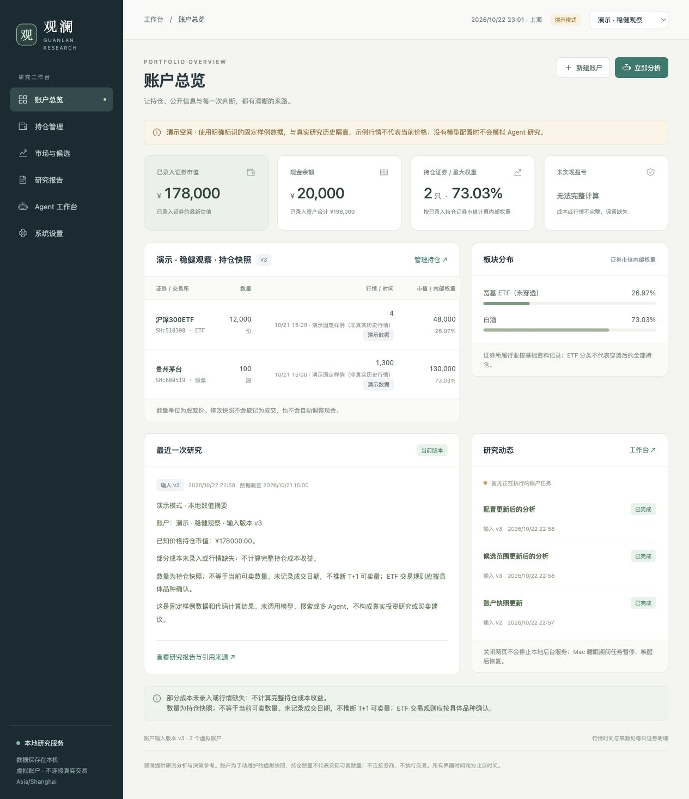

# 观澜（Guanlan）

运行在 Mac 本机的 A 股与场内 ETF 虚拟账户多 Agent 投资研究工作台。基于 FastAPI + SQLite + asyncio 后台执行器与无构建依赖的原生 JavaScript 界面，所有数据与运行状态均保存在本机。



---

## 一、项目介绍与目标

**观澜**面向个人投资者，旨在打造一个「账目精确、证据可溯、结论克制、完全本机可控」的虚拟投资研究工作台。

项目的核心设计目标：

1. **精确账务与账户隔离**：多虚拟账户独立维护资金、持仓、含费成本、自选列表与研究上下文。所有金额、份额、盈亏与占比均由后端代码使用 `Decimal` 精确计算；缺失数据保持未知，禁止模型猜测或补造。跨账户仅共享行情与原始公开资料，不借用其他账户或公共模型的投资结论。
2. **多 Agent 协作与原文可溯**：主 Agent 与公告披露、市场价格、行业政策、ETF 指数、组合配置等子角色拥有各自独立的模型上下文与真实工具调用循环，支持模型原生联网与本地研究工具协作。每份研究报告的引用均可定位到已保存的原始文档版本、页码或片段范围。
3. **客观评估与风险边界**：支持按固定交易日规则记录前瞻预测，到期后由后端代码根据真实日线数据确定性评分，并将正式预测与探索记录严格分离。系统坚持**只做研究与模拟记账，不连接真实券商，不执行真实下单**。

---

## 二、能力范围

### 1. 虚拟账户与精确账本
- 支持多账户创建、期初现金与期初持仓导入、自选列表与全局候选范围维护。
- 支持六位证券代码识别（如 `518880`、`002354`、`159278`），同时兼容 `SH:` / `SZ:` 规范格式。
- 支持手动录入模拟买入/卖出、资金转入/转出、自定义股票与 ETF 佣金/最低收费/过户费方案，以及带差异预览的期初/快照校正。

### 2. 多供应商与统一 Agent 角色管理
- 支持任意兼容 **Responses** 或 **Chat Completions** 协议的模型接口；API Key 写入 macOS 系统钥匙串，前端仅展示已配置状态与掩码。
- 保存供应商后自动发现可用模型目录，支持刷新、搜索与分页，不伪造未发现的热门模型。
- 支持全局统一配置主 Agent 与各研究子角色的默认供应商、模型与 `reasoning_effort`（`low`、`medium`、`high`、`xhigh`、`max`，不自动降档），并支持在单账户维度按角色覆盖。
- 后台任务领取时冻结完整模型目录、角色提示词/工具版本、有效模型绑定与凭据修订，在途任务不受后续配置修改影响。

### 3. 多 Agent 深度研究与执行控制
- 本地代码负责主/子 Agent 调度、事件邮箱回传、结果校验与原子发布；支持 Responses 原生 `web_search` 与本地函数工具协同工作。
- 支持提示词前缀稳定与缓存标识透传（Responses `prompt_cache_key`、Chat 请求级 `x-grok-conv-id`），并按请求和阶段记录 token 与缓存命中用量。
- 内置重复查阅无进展收敛守卫、有界流式超时控制，以及基于可见研究检查点的受控恢复机制。

### 4. 行情刷新、资讯观察与定时调度
- 默认使用东方财富公开网页行情，失败时可回退至新浪公开网页报价（可关闭）；休市阶段在报价不可用时可回退读取最近有效未复权日线收盘价并标注日期精度；研究数据源支持可选的 Tushare 认证接入。
- 按 `Asia/Shanghai` 交易时段运行定时任务：默认每 60 秒刷新行情、每 5 分钟扫描全局候选、每 15 分钟综合分析、15:15 生成收盘总结，以及 08:00–23:00 每 30 分钟按配置主题执行资讯观察。
- 「定时研究」「基础行情刷新」「已发布预测的评估」三类后台任务可独立启停，互不误伤。

### 5. 投资建议追踪与前瞻预测评估
- 结构化建议在价格条件满足、期限变化、新资讯到达或账户输入版本变更时自动更新状态，并提示待复核事项。
- 每个账户可单独开关「正式预测批次」（默认关闭，开启后每交易日按配置发起研究）。默认在收盘后 `15:30` 发起、`18:00` 截止，短/中/长线分别为未来 `1 / 5 / 20` 个交易日，震荡阈值 `±0.5%`（均可自定义）。到期后由代码按真实日线评分，统计准确率、覆盖率、弃权、待到期与待数据状态。

---

## 三、环境要求与启动命令

### 环境要求
- **操作系统**：macOS（推荐 Apple Silicon；服务监听本机回环地址）
- **Python**：3.12 及以上（推荐配合 `uv` 管理虚拟环境）
- **日常运行**：无需 Node.js、npm 或外部 CDN，仅运行单个本地后台进程
- **开发期浏览器测试**：需要 Node.js 20+ 与 Playwright

### 首次安装与启动（推荐 `uv`）

```sh
uv sync --frozen
./start.command
```

也可以在 Finder 中直接双击 `start.command` 启动（若 `.venv` 已存在不会重复安装依赖）。启动后在浏览器打开：

```text
http://127.0.0.1:8765
```

### 不使用 `uv` 时启动

```sh
python3 -m venv .venv
.venv/bin/pip install -r requirements.txt
.venv/bin/python scripts/manage.py start
```

### 体验演示模式（不消耗模型费用）

演示模式使用完全独立的 `data/demo.sqlite3`、明确标注的固定价格与本地计算摘要，**不会调用或模拟真实大模型与新闻研究**：

```sh
./start.command --mode demo
```

启动后访问 `http://127.0.0.1:8766` 并点击「创建演示样例」。停止演示模式：

```sh
./stop.command --mode demo
```

### 常用运维命令

```sh
# 停止正式服务
./stop.command

# 查看后台进程与运行状态
.venv/bin/python scripts/manage.py status

# 前台启动（用于本地排障，实时输出日志）
.venv/bin/python scripts/serve.py
```

后台运行日志位于 `data/live.log`（演示模式为 `data/demo.log`）。服务仅监听 `127.0.0.1`，禁止跨站写请求；**请勿启动多个 Uvicorn worker**，数据库文件锁会阻止同库启动第二个后台进程。

---

## 四、配置方法

### 1. 网页端配置（推荐）

首次启动后无需手工编写模型密钥到 `.env`，直接在网页端完成配置：

1. **模型供应商**：填写供应商名称、Base URL、API Key（后端存入 macOS 钥匙串）、协议（`responses` / `chat_completions`）及网络路由（`environment` 跟随环境代理，或 `direct` 直连）。粘贴 `/responses` 或 `/chat/completions` 完整地址时会自动规范化为 API 根路径。
2. **Agent 角色**：为主 Agent 及各研究子角色选择供应商、已发现模型和默认 `reasoning_effort`。
3. **账户模型**：创建虚拟账户后，默认继承全局角色绑定；可按需为单个账户覆盖特定角色的模型或推理强度。
4. **运行与预算设置**：
   - 默认分层超时：首有效事件 `90s`、流空闲 `300s`、普通请求硬限 `900s`、汇总请求硬限 `900s`、子任务总预算 `1800s`、整轮分析预算 `3600s`。
   - 输出上限（`max_output_tokens`）：默认留空（不向模型发送输出长度上限参数，由上游决定）；可按需填写具体值。
   - 模型调用次数上限：单任务最大 HTTP 次数（默认 `40`）、汇总最大次数（默认 `4`）与 Agent 最大轮次（默认 `12`）均支持显式留空设为不限，但仍受总预算、截止时间与无进展收敛守卫约束。
5. **预测评估与后台开关**：在「预测评估」页按账户显式开启正式预测批次；在设置页按需开关定时研究、基础行情刷新和到期评估。

### 2. 环境变量配置（`.env`，可选）

如需定制端口、数据源、代理或兼容旧环境变量凭据，可复制模板文件并按需修改：

```sh
cp .env.example .env
```

常用变量说明：

| 变量名 | 默认值 | 说明 |
| --- | --- | --- |
| `APP_MODE` | `live` | 运行模式：`live` 或 `demo` |
| `APP_HOST` / `APP_PORT` | `127.0.0.1` / `8765` | 监听地址与端口（演示模式默认端口 `8766`） |
| `MODEL_PROTOCOL` | `responses` | 默认协议：`responses` 或 `chat_completions` |
| `MODEL_BASE_URL` | `https://api.openai.com/v1` | 默认模型 API 根地址 |
| `MODEL_NAME` | 空 | 兼容迁移用的默认模型名（推荐在网页端目录选择） |
| `MODEL_KEY_ENV` / `MODEL_API_KEY` | `MODEL_API_KEY` / 空 | 环境变量凭据名及对应 Key（仅后端读取，不进入前端） |
| `MODEL_NATIVE_SEARCH` | `true` | 是否默认启用模型原生联网搜索（需 Responses 端点实际支持） |
| `REASONING_EFFORT` | `medium` | 默认推理强度：`low` / `medium` / `high` / `xhigh` / `max` |
| `QUOTE_PROVIDER` | `eastmoney` | 实时行情主数据源（设为 `manual` 可停用联网行情） |
| `QUOTE_FALLBACK_PROVIDER` | `sina` | 行情失败兜底源（设为 `none` 关闭） |
| `RESEARCH_PROVIDER` | `eastmoney` | 研究数据源（可选 `tushare` 并填写 `TUSHARE_TOKEN`） |
| `STOCK_CALENDAR_PATH` | 内置 2026 年日历 | 可指向单个交易日历 JSON 或包含 `calendar_*.json` 的目录 |

> 说明：修改 `.env` 后需重启服务生效；当前 Shell 中已导出的同名环境变量优先级高于 `.env` 文件。

---

## 五、备份、恢复与升级

- **数据位置**：正式数据保存在 `data/live.sqlite3`（当前数据库 `schema 11` / `API contract 13`）。
- **创建备份**：在网页端点击「备份数据库」，会在 `data/backups/` 生成时间戳 SQLite 备份文件。备份包含账户、账本、材料、报告、预测与安全凭据引用，**不包含 macOS 钥匙串中的实际 API Key 和 `.env` 文件**。请勿将数据库、备份或 `.env` 提交到公开仓库。
- **恢复备份**：

```sh
./stop.command
.venv/bin/python scripts/restore.py data/backups/live-YYYYMMDD-HHMMSS-ffffff.sqlite3 --mode live
./start.command
```

恢复脚本会校验数据库完整性与运行模式，拒绝覆盖正在运行中的库，并在覆盖前自动备份当前库。换机恢复后需在网页端重新录入供应商 API Key。

- **升级重启**：拉取新代码后，先在页面备份数据库，再执行：

```sh
./stop.command --mode live
uv sync --frozen
./start.command --mode live
```

---

## 六、开发与测试

自动化测试默认使用确定性模型替身与隔离临时数据库，**不会产生真实模型费用，也不会修改日常 `data/live.sqlite3`**。

```sh
# 运行全量 Python 单元与集成测试
.venv/bin/python -m pytest

# 安装并运行全量 12 组 Chromium 浏览器行为回归测试
npm ci
npx playwright install chromium
PYTHON=.venv/bin/python npm run test:browser
```

---

## 七、目录结构与核心文档

### 代码结构
- `app/main.py` / `app/sixth_api.py` / `app/ledger_api.py`：FastAPI 接口、本地安全边界、设置校验与前端静态资源服务。
- `app/agents.py` / `app/model.py` / `app/model_cache.py` / `app/model_usage.py` / `app/research_progress.py`：主/子 Agent 协作循环、协议续接、缓存标识、用量统计与无进展收敛守卫。
- `app/store.py` / `app/ledger.py` / `app/materials.py` / `app/recommendations.py` / `app/scheduling.py` / `app/recovery.py` / `app/task_tracking.py`：SQLite 持久化、精确账本、原始材料版本、建议生命周期、任务调度与检查点恢复。
- `app/forecasts.py` / `app/forecast_prices.py` / `app/forecast_windows.py` / `app/calendar.py`：前瞻预测批次、真实日线取价评分与交易所日历。
- `app/agent_config.py` / `app/credentials.py` / `app/providers.py` / `app/symbols.py`：多供应商与角色配置、钥匙串集成、行情与公开数据源、证券代码解析。
- `app/prompts/`：主 Agent 与各具名研究角色的初始提示词模板。
- `app/static/`：无构建依赖的原生前端页面与脚本。
- `scripts/`：启停管理（`manage.py`、`serve.py`）、备份恢复（`restore.py`）及受控评估脚本。
- `tests/`：Python 测试套件与 12 组 Playwright Chromium 端到端回归测试。

### 延伸文档
- [系统架构说明](docs/architecture.md)
- [Agent 编排与协作说明](docs/agents.md)
- [行情与数据源说明](docs/providers.md)
- [前瞻预测评估口径](docs/forecast-evaluation.md)
- [Mac 本地运维与升级手册](docs/mac-operations.md)
- [测试与验证说明](docs/verification.md)

---

## 八、明确边界与尚未完成的地方

### 明确不做的范围（非目标）
- **无真实交易能力**：不读取真实券商账户、不登录券商、不自动下单、不撮合交易，也不作任何投资收益承诺。
- **仅限单机个人使用**：不提供多用户登录与公网远程认证，仅监听本机回环地址；数据库备份与日历维护由本机用户负责。

### 尚未完成或仍存在限制的地方
1. **正式前瞻预测与自然到期评分闭环尚未完成充分实证**：正式预测窗口（收盘后 `15:30–18:00`）的连续实盘运行，以及 `1 / 5 / 20` 个交易日自然到期后的长期样本准确率尚未积累足够真实样本，当前不能作为真实胜率或收益有效性的证明。
2. **行情与 ETF 深度数据仍有缺口**：免费公开行情依赖第三方网页端点，受限流与站点可用性影响；目前无法从现有公开端点完整获取停牌状态、北京市场全量映射、ETF 底层持仓穿透、日均跟踪偏离/跟踪误差与折溢价等精细指标。
3. **非文本材料解析与选股范围受限**：当前支持网页正文与可提取文本的 PDF，不支持扫描版 PDF 的 OCR 识别；候选机会发现仅限于用户配置的股票池及相关公开研究，不提供全市场自动选股池。
4. **缺少策略回测与系统级常驻托管**：尚未实现历史策略回测引擎；未自动安装 macOS LaunchAgent 开机自启，也没有系统级推送通知（Mac 睡眠期间后台任务会暂停，唤醒后按最新数据重新判断执行；退出服务或重启电脑后需手动再次启动）。
5. **外部模型接口兼容性与计费依赖上游实现**：不同第三方模型接口或中转网关对 `reasoning_effort`、原生 `web_search`、提示词缓存标识（`prompt_cache_key` / `x-grok-conv-id`）以及长流式连接稳定性的支持存在差异，实际效果与真实账单需以所用供应商为准。
6. **交易日历需逐年人工维护**：仓库默认内置 2026 年沪深北交易所休市安排，跨年后需通过 `STOCK_CALENDAR_PATH` 补充新一年已核实的交易所日历，未覆盖年份的预测目标日将保持未知。
