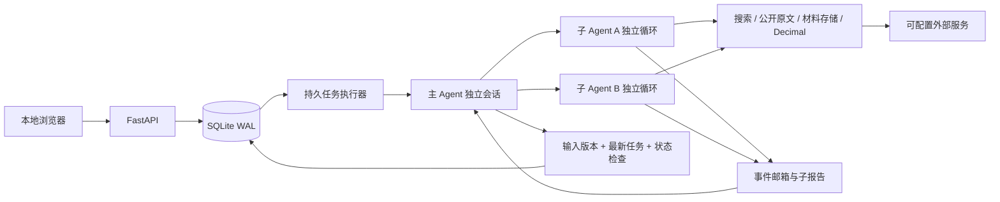

# 架构与一致性边界

一个本机进程管理 HTTP 和后台 asyncio 任务，网页只是客户端。SQLite 使用 WAL 和短事务，保存新账户输入时在同一事务写入版本快照、使旧报告失效、取消待运行旧任务并建立新任务。快速编辑将队列合并到最新版本；运行中的任务下一次服务 tick 被取消。

发布结果时使用 `BEGIN IMMEDIATE`：必须同时满足账户仍存在、输入版本相同、账户的 latest_job_id 相同以及任务仍为 running。否则结果只能作为 stale 历史保存；取消与迟到均不会回滚输入。重复结果发布幂等。比较上一报告时只选择曾有效完成的任务，不选择后来才到达的过期结果。

周期、事件与收盘需求先写入 research_demands；未开始的执行可合并需求，运行中的任务保留独立后续需求。只有用户输入变更或显式重试才替换执行任务。global_runs 承载一次全局候选/市场研究，其记录可供各账户复用；账户分析按创建时间公平领取。需求拥有 assigned/completed/failed 状态与合并原因，调度时间桶只表示已持久登记，不表示研究已完成。

两个账户的输入、任务、报告和模型会话独立。模型提取的材料默认按账户关联，避免把账户相关分析传入另一账户；仅搜索结果和原文等公共资料进入跨账户缓存。材料 ID 可按主键长期取回，不受列表分页窗口限制。材料分类字段允许扩展、不完整和未知；没有可信度分数、白名单或交叉来源硬门槛。去重指纹只是存储幂等，不代替 Agent 识别同一公告转载、更正和报告期差异。

主 Agent 可直接工具研究，也可动态创建子任务。事件驱动 condition 唤醒用于等待阶段发现与完成；管理动作不依赖网页轮询。子 Agent 保留独立会话，后续任务进入同一会话；取消会补齐工具边界，使需要时可继续。账户任务被取消时会级联取消子任务，已经收集的材料仍保留。模型原始隐藏推理不写到 UI/事件日志。

进程重启时，重新排队仍对应最新输入的 running 任务，并在配置已满足时恢复最新 waiting_config 任务；恢复重跑可能再次产生模型费用，通过尝试次数和调用预算限制。过期已完成报告在服务启动后排入重新研究。唤醒检测同时看墙上时钟和单调时钟间隔，将错过的周期合并至当前窗口并保存范围说明；保留已登记的需求，跨日恢复补充上次已观察交易日的收盘复核。交易时段、节假日、收盘调度都使用上海时区和有覆盖边界的日历。

模型和研究工具无法修改账户、设置、环境或执行 shell。原文读取限制为公开 HTTP(S)，每次重定向检查 IP 并固定连接目标；内容是模型的数据。该限制保护本机资源，不裁决来源观点或可信度。密钥只由后端从指定环境变量读取，不进入账户上下文和日志。API 默认仅回环访问，Host 与写请求 Origin 校验防止网页跨站操作本机服务。

默认两个账户任务并发，每轮最多三个活跃子 Agent；每个任务有全局模型请求预算、子任务数、上下文字符和总时间上限。达到预算时显示明确失败，阶段材料保留。首版不在预算耗尽时偷偷改用伪造回答或规则生成买卖建议。

建议与自然语言报告独立存储，程序仅计算明确的数值条件。建议新证券自动进入行情监控，旧输入需要重新评估，过期状态不可继续视为有效。语义相同的价格条件通过持久锁存避免重复费用；主 Agent 明确撤销或提交同证券新建议才撤销旧建议。公开资讯版本与通知 outbox 同事务保存，通知登记完成才标记已送达。

材料列表使用独立轻量索引，原文版本不可变；读取范围、来源、全文下载 hash 与旧版本可追溯。工具上下文在协议完整边界归档，Agent 可通过 recall_context 重新取回自己的可见记录。完整材料不再经每次列表/前端轮询重复传输。
