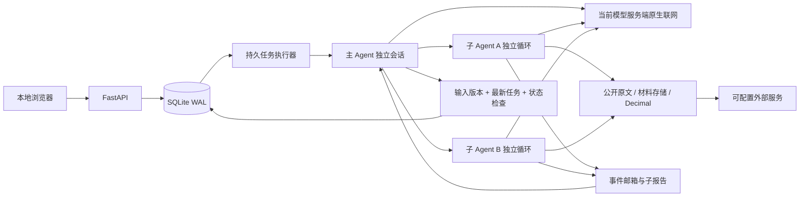

# 架构与一致性边界

一个本机进程管理 HTTP 和后台 asyncio 任务，网页只是客户端。SQLite 使用 WAL 和短事务，保存新账户输入时在同一事务写入版本快照、使旧报告失效、取消待运行旧任务并建立新任务。快速编辑将队列合并到最新版本；运行中的任务下一次服务 tick 被取消。

发布结果时使用 `BEGIN IMMEDIATE`：必须同时满足账户仍存在、输入版本相同、账户的 latest_job_id 相同以及任务仍为 running。否则结果只能作为 stale 历史保存；取消与迟到均不会回滚输入。重复结果发布幂等。比较上一报告时只选择曾有效完成的任务，不选择后来才到达的过期结果。

周期、事件与收盘需求先写入 research_demands；未开始的执行可合并需求，运行中的任务保留独立后续需求。只有用户输入变更或显式重试才替换执行任务。global_runs 承载一次全局候选/市场研究，其记录可供各账户复用；账户分析按创建时间公平领取。需求拥有 assigned/completed/failed 状态与合并原因，调度时间桶只表示已持久登记，不表示研究已完成。

两个账户的输入、任务、报告和模型会话独立。模型提取的材料默认按账户关联，避免把账户相关分析传入另一账户；仅搜索结果和原文等公共资料进入跨账户缓存。材料 ID 可按主键长期取回，不受列表分页窗口限制。材料分类字段允许扩展、不完整和未知；没有可信度分数、白名单或交叉来源硬门槛。去重指纹只是存储幂等，不代替 Agent 识别同一公告转载、更正和报告期差异。

主 Agent 可直接工具研究，也可动态创建子任务。事件驱动 condition 唤醒用于等待阶段发现与完成；管理动作不依赖网页轮询。子 Agent 保留独立会话，后续任务进入同一会话；取消会补齐工具边界，使需要时可继续。账户任务被取消时会级联取消子任务，已经收集的材料仍保留。模型原始隐藏推理不写到 UI/事件日志。

进程重启时，重新排队仍对应最新输入的 running 任务，并在配置已满足时恢复最新 waiting_config 任务；恢复重跑可能再次产生模型费用，通过尝试次数和调用预算限制。过期已完成报告在服务启动后排入重新研究。唤醒检测同时看墙上时钟和单调时钟间隔，将错过的周期合并至当前窗口并保存范围说明；保留已登记的需求，跨日恢复补充上次已观察交易日的收盘复核。交易时段、节假日、收盘调度都使用上海时区和有覆盖边界的日历。

模型和研究工具无法修改账户、设置、环境或执行 shell。原文读取限制为公开 HTTP(S)，每次重定向检查 IP 并固定连接目标；内容是模型的数据。该限制保护本机资源，不裁决来源观点或可信度。密钥只由后端从指定环境变量读取，不进入账户上下文和日志。API 默认仅回环访问，Host 与写请求 Origin 校验防止网页跨站操作本机服务。

默认两个账户任务并发，每轮最多三个活跃子 Agent；每个任务有全局模型请求预算、子任务数、上下文字符和总时间上限。达到预算时显示明确失败，阶段材料保留。首版不在预算耗尽时偷偷改用伪造回答或规则生成买卖建议。

建议与自然语言报告独立存储，程序仅计算明确的数值条件。建议新证券自动进入行情监控，旧输入需要重新评估，过期状态不可继续视为有效。语义相同的价格条件通过持久锁存避免重复费用；主 Agent 明确撤销或提交同证券新建议才撤销旧建议。公开资讯版本与通知 outbox 同事务保存，通知登记完成才标记已送达。

材料列表使用独立轻量索引，原文版本不可变；读取范围、来源、全文下载 hash 与旧版本可追溯。工具上下文在协议完整边界归档，Agent 可通过 recall_context 重新取回自己的可见记录。完整材料不再经每次列表/前端轮询重复传输。

## 第三轮数据身份与事件闭环

材料保存分四层：来源、原始文档版本、读取表示、Agent 提取或生成结果。`document_version_id` 标识同版原始内容；每个已存片段保留原有或独立 `material_id`、页码、偏移和提取范围。取得原始字节时使用 `raw_bytes_sha256`；只有摘要/文本时使用 `representation_sha256`，明确不是原始文件哈希。摘要、原文、提取结果、生成研究互不覆盖。同版从 12,000 字符扩展到 40,000 字符，或换页读取，只增加表示；相同 URL 和发布时间下字节实际改变仍建立新版本。

`notify=True` 不再依赖材料是否刚创建。通知按文档版本的锚点材料幂等登记，Agent 先入库的版本也能补建 outbox。通知处理依次可靠登记公共研究、各账户需求与建议复核，再确认投递完成；中途退出后重放稳定事件键，不重复创建同一需求。普通重读不重新发送已投递事件，Agent 生成研究也不回流为新的外部客观消息。

建议的 `price_state` 与 `review_status` 独立。建议待复核仍检查新报价；新材料、输入版本变化、过期或报价不再可用均保留可观察处理状态。研究需求按建议和原因去重；相同问题自动补做后仍未解决，转为 `waiting_review` 并提供显式重试，避免静默遗失或无限自我重算。局部任务只影响目标证券。主动维持/更新后，服务端绑定已核实的账户输入版本。

查询先按活跃、价格满足、待复核或历史范围筛选，再排序分页。Agent 的分页覆盖信息与事件关联项不会被大量历史建议挤掉。兼容查询保留全部状态且活跃优先；页面明确调用活跃/历史分页接口，不把历史状态当当前建议。

公共研究与候选范围单调版本绑定。任务保存 `universe_version` 和配置/候选快照；发布时重新比较当前范围。旧任务的 `global_runs` 与 `research_records` 均保留历史适用性，不通过记录 upsert 覆盖新范围结论。共享研究默认只读取当前适用记录；旧范围采集的原始材料仍按既有访问权限可读。账户结果另存所用范围和共享记录列表。

引用解析只验证 ID 存在、当前可访问范围和可定位位置，生成 `resolved`、`source_link`、`unresolved`。账户报告、建议及研究记录采用同一解析；前端未解析项不提供假证据按钮。材料 HTTP 列表、详情与分段请求不带 `account_id` 时仅返回公共范围，带参数时允许公共及该账户材料；未知与其他账户材料给出相同缺口说明。该范围检查不替代本机认证，也不是事实核验模块。

schema 3 的迁移先在线保存 `.before-v3.bak`，再幂等增加版本、表示、范围及状态数据。旧材料 ID、引用、账户与历史建议保留；缺失原始字节身份、完整读取状态或公共研究范围时标记未知。恢复脚本接受支持的历史 schema，拒绝更新版本或错误运行模式；重新启动会按当前代码迁移。

## 第四轮增量

采集开始时通过 SQLite 分配不可由网页/模型指定的观测ID与单调序号；缓存保留原观测，进程重启序号不重置。迟到结果可存可引，但不推进最新资料、不触发更正；新序号下真实 A→B→A 仍形成新版本。无法排序的变更保留 version=0/unknown 顺序，不编造发布者更正。

`material_ids` 与 `source_material_ids` 在入口取排序去重并集，两者冲突保留全部且解析缺口；父集合参与提取身份。旧丢失关系不补造。原生来源是 source_link 或 visible_excerpt，和本地原文、生成提取分开；保存链接不附原始字节哈希。

资讯扫描登记公共研究需求，复用现有公共 Agent 与预算。材料 outbox 先保持 pending，公共报告和关联计划同事务保存，随后幂等投递账户与建议。中断后直接恢复已存路由，不重新调用模型。生成报告不进入外部通知链。schema4 升级前保存 `.before-v4.bak`；旧搜索值保留审计，但不进入新设置和运行路径。

第五轮的资讯投递范围合并账户当前非零持仓、活跃建议和全局候选证券；当前没有结构化账户排除字段，自选观察列表本身不扩展候选范围。公共 Agent 明确判断为市场级的消息可投递全部账户，证券和行业事件按实际范围匹配。未知关联、缺少相关目标或行业分类缺失不能自动广播：outbox 保持 pending，路由标记 awaiting_retry，并保留已确认与未解决的账户范围。普通轮询不为同一待查事件反复调模型；后续定时、显式重试或新事件启动的公共研究可以继续判断。

分发计划先落库为 ready，下游需求全部持久化后才标记 routed 并确认 outbox；中断重放使用稳定需求键。尚未完成的投递按恢复时的当前候选范围匹配；已经 routed 而尚未确认的计划只补确认，不重新扩散到后来加入的范围。范围修改本身仍登记 universe_changed 研究。单份材料第一次实际投递的事件身份另行持久化，后续补充或改写语义 event_key 不会给已经覆盖的账户重复建立需求；不同材料的同一已识别语义事件按公共 Agent 提供的 event_key 去重。
